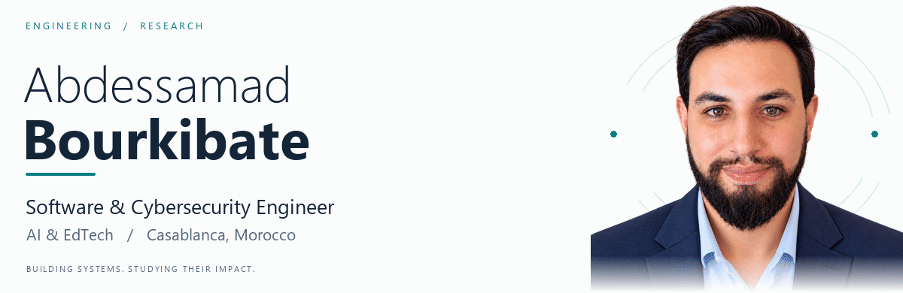

<a href="https://orcid.org/0009-0000-6186-8071">
  <picture>
    <source media="(prefers-reduced-motion: reduce) and (prefers-color-scheme: dark)" srcset="assets/hero-dark.png">
    <source media="(prefers-reduced-motion: reduce)" srcset="assets/hero-light.png">
    <source media="(prefers-color-scheme: dark)" srcset="assets/hero-dark.gif">
    <source media="(prefers-color-scheme: light)" srcset="assets/hero-light.gif">
    
  </picture>
</a>

  <a href="https://orcid.org/0009-0000-6186-8071"><b>ORCID</b></a> &nbsp; · &nbsp;
  <a href="https://scholar.google.com/citations?user=g9xg-vYAAAAJ"><b>Google Scholar</b></a> &nbsp; · &nbsp;
  <a href="https://www.researchgate.net/profile/Abdessamad-Bourkibate-2"><b>ResearchGate</b></a> &nbsp; · &nbsp;
  <a href="https://www.linkedin.com/in/abdessamad-bourkibate-b17717350/"><b>LinkedIn</b></a> &nbsp; · &nbsp;
  <a href="docs/CV.md"><b>Research CV</b></a> &nbsp; · &nbsp;
  <a href="mailto:a.bourkibate@share-in.ma"><b>Contact</b></a>

### Engineering with a research perspective

I am **Abdessamad Bourkibate**, a Software & Cybersecurity Engineer at **Share'In Holding**, based in Casablanca, Morocco. I work across software development, artificial intelligence and educational technology, with a focus on useful, secure digital systems.

My academic studies bring together **Computer Science at the University of the People** and **Quranic Studies at Al Madinah International University**. My research interests connect reliable machine learning and privacy engineering with digital ethics, family cybersecurity and Islamic legal thought.

<b>Read my professional and academic background</b>

 

| Area | Current focus |
| :--- | :--- |
| Professional work | Software & Cybersecurity Engineer · AI & EdTech · Share'In Holding |
| Computer Science | Undergraduate studies in progress · University of the People, United States |
| Quranic Studies | Undergraduate studies in progress · Al Madinah International University, Malaysia |
| Technical research | Reliable machine learning, Wi-Fi sensing, missing observations, privacy and zero-trust systems |
| Interdisciplinary research | Family cybersecurity, digital childhood, digital ethics, Islamic law and technology |

I develop research software and study how technical design choices affect the reliability and social consequences of digital systems. My work includes Wi-Fi CSI activity recognition, privacy-oriented education architectures, and interdisciplinary writing on family cybersecurity.

[Full research CV](docs/CV.md) · [Bibliographic records](references.bib) · [SciProfiles](https://sciprofiles.com/profile/4765148)

### Selected projects

| Project | What I work on | Explore |
| :--- | :--- | :--- |
| **MIRA-CSI** | Experimental Wi-Fi CSI activity recognition and reproducible evaluation under missing measurements and environment–cohort change. | [Code](https://github.com/ABDESSAMAD-BOURKIBATE/mira-csi) · [Model card](https://github.com/ABDESSAMAD-BOURKIBATE/mira-csi/blob/main/MODEL_CARD.md) · [Preprint](https://doi.org/10.20944/preprints202610.2930.v1) |
| **AFRICA-ZT-EDU** | Research materials for a policy-centric zero-trust and privacy-preserving architecture for cross-border digital education. | [Repository](https://github.com/ABDESSAMAD-BOURKIBATE/AFRICA-ZT-EDU-Reproducible-Research) · [Software record](https://doi.org/10.5281/zenodo.22003109) |
| **FamilySec-Pro** | A software project exploring phishing, suspicious links and unsafe-message detection in family communication. | [Repository](https://github.com/ABDESSAMAD-BOURKIBATE/FamilySec-Pro) |

### Research & publications

**Wireless sensing & machine learning**

- [Reliability Assessment of Wi-Fi CSI-Based Activity Recognition Under Environmental Shift and Structured Measurement Loss](https://doi.org/10.20944/preprints202610.2930.v1) — *Preprints.org*, 2026. **Preprint**.
- [Entropy-Driven Gradient Stability in Large Language Models: A Non-Equilibrium Thermodynamic Framework for Reinforcement Learning Optimization](https://doi.org/10.21203/rs.3.rs-8812364/v1) — *Research Square*, 2026. **Preprint**.

**Family cybersecurity, privacy & digital society**

- [Family Cybersecurity Jurisprudence (FCJ): A Foundational Interdisciplinary Framework Integrating Islamic Legal Theory, Cybersecurity Engineering, and Digital Family Psychology](https://doi.org/10.2139/ssrn.6099606) — *SSRN*, 2026. **Preprint**.
- [Risk to Obligation Mapping in Family Cybersecurity Jurisprudence: A Normative-Operational Supplement](https://doi.org/10.31219/osf.io/vd8ye_v1) — *OSF Preprints*, 2026. **Preprint**.
- [Quantifying Vulnerability in Sociotechnical Family Systems: A Centrality-Based Mitigation Framework](https://doi.org/10.36227/techrxiv.176948811.18136133/v1) — *TechRxiv*, 2026. **Preprint**.

<b>More research, Arabic work & citation files</b>

 

- [The Sovereign Home Protocol: Re-Engineering Digital Immunity Through Embedded Network Isolation and the Axiological Dimension of Privacy](https://doi.org/10.2139/ssrn.5935436) — *SSRN*, 2026. Working paper.
- [فقه الأمن السيبراني الأسري وتحديات السيادة الرقمية: مقاربة تأصيلية في ضوء القواعد الفقهية والتشريعات القانونية](https://www.ruaafikriya.net/fr/articles/c3d7ff05-9284-4491-9f29-6b64d57e90a3) — *مجلة رؤى فكرية*, 2026, issue 2.
- [الطفولة الرقمية في المغرب: الذكاء الاصطناعي والذكاء العاطفي من منظور فقه الأمن السيبراني الأسري](https://doi.org/10.5281/zenodo.17167669) — *Zenodo*, 2025. Research proposal.
- [دليل فقه الأمن السيبراني الأسري](https://doi.org/10.5281/zenodo.17108085) — *Zenodo*, 2025. Guide.
- [ترند Ghibli Style في عصر الذكاء الاصطناعي: قراءة تحليلية بين الإبداع والتأثير الاجتماعي في سياق مشروع Veo Google](https://doi.org/10.13140/RG.2.2.20973.50406) — *ResearchGate*, 2025. Research manuscript.

[Download the curated BibTeX references](references.bib) · [Browse the full ORCID record](https://orcid.org/0009-0000-6186-8071)

### Languages & tools

| Languages | Research & ML | Applications | Workflow |
| :--- | :--- | :--- | :--- |
| Python · JavaScript · TypeScript | PyTorch · scikit-learn · NumPy · pandas | React · Django · Flask | Git · Docker · Jupyter · LaTeX |

### Collaboration

I welcome focused collaboration on **reliable ML, privacy engineering, wireless sensing, educational technology and family cybersecurity**. For a project discussion, use [my professional email](mailto:a.bourkibate@share-in.ma). For software questions and reproducible bug reports, use the relevant repository's issue tracker.

Abdessamad Bourkibate · Casablanca, Morocco · <a href="https://orcid.org/0009-0000-6186-8071">ORCID 0009-0000-6186-8071</a>

