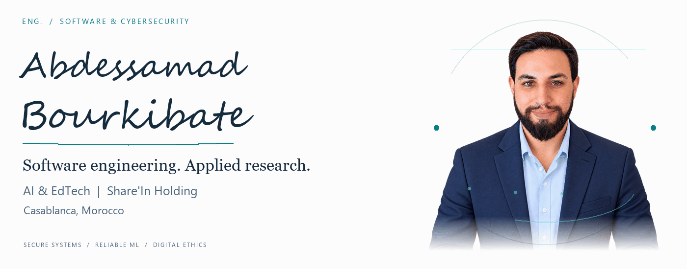
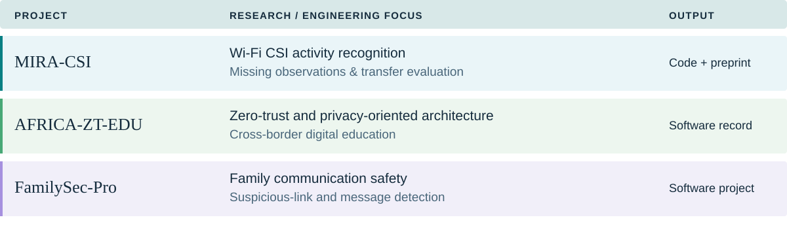

<a href="https://orcid.org/0009-0000-6186-8071">
<picture>
  <source media="(prefers-reduced-motion: reduce) and (prefers-color-scheme: dark)" srcset="assets/editorial/hero-dark.png">
  <source media="(prefers-reduced-motion: reduce)" srcset="assets/editorial/hero-light.png">
  <source media="(prefers-color-scheme: dark)" srcset="assets/editorial/hero-dark.gif">
  <source media="(prefers-color-scheme: light)" srcset="assets/editorial/hero-light.gif">
  
</picture>
</a>

<samp>SOFTWARE ENGINEERING &nbsp; / &nbsp; CYBERSECURITY &nbsp; / &nbsp; APPLIED RESEARCH</samp>

<a href="#profile">Profile</a> &nbsp; · &nbsp;
<a href="#path">Academic path</a> &nbsp; · &nbsp;
<a href="#projects">Projects</a> &nbsp; · &nbsp;
<a href="#technology">Languages & tools</a> &nbsp; · &nbsp;
<a href="#publications">Publications</a> &nbsp; · &nbsp;
<a href="docs/CV.md">Research CV</a>

<h3>
<picture>
  <source media="(prefers-color-scheme: dark)" srcset="assets/editorial/section-profile-dark.svg">
  <source media="(prefers-color-scheme: light)" srcset="assets/editorial/section-profile-light.svg">
  
</picture>
</h3>

I am **Abdessamad Bourkibate**, a <ins>Software & Cybersecurity Engineer</ins> at **Share'In Holding**, based in **Casablanca, Morocco**. My work brings together software engineering, artificial intelligence and educational technology, with an interest in systems that are useful, secure and understandable to the people who depend on them.

My academic path combines **Computer Science at the University of the People, United States**, and **Quranic Studies at Al Madinah International University, Malaysia**. Both are undergraduate studies in progress. This combination informs my interest in the technical, ethical and social dimensions of digital systems.

My research covers **reliable machine learning, Wi-Fi sensing, digital privacy, family cybersecurity and technology-supported learning**. I also explore the relationship between Islamic legal thought, digital ethics, online protection and the governance of artificial intelligence.

I develop research software, document experiments and write across these connected areas. **MIRA-CSI** examines activity recognition from recorded Wi-Fi channel state information; **AFRICA-ZT-EDU** explores privacy-oriented education architectures; my interdisciplinary writing considers the protection of individuals and families in digitally connected environments.

<h3>
<picture>
  <source media="(prefers-color-scheme: dark)" srcset="assets/editorial/section-path-dark.svg">
  <source media="(prefers-color-scheme: light)" srcset="assets/editorial/section-path-light.svg">
  
</picture>
</h3>

**Professional work**

**Share'In Holding — Software & Cybersecurity Engineer | AI & EdTech** 
Casablanca, Morocco

My professional interests span secure software development, intelligent applications and digital learning systems. I connect implementation work with research questions about reliability, privacy and the human consequences of technical decisions.

**Academic studies**

| Institution | Area of study | Current status |
| :--- | :--- | :--- |
| **University of the People** · United States | Computer Science | Undergraduate studies in progress |
| **Al Madinah International University** · Malaysia | Quranic Studies | Undergraduate studies in progress |

**Research identity**

| Record | Reference |
| :--- | :--- |
| ORCID | [0009-0000-6186-8071](https://orcid.org/0009-0000-6186-8071) |
| Research profile | [Google Scholar](https://scholar.google.com/citations?user=g9xg-vYAAAAJ) · [ResearchGate](https://www.researchgate.net/profile/Abdessamad-Bourkibate-2) |
| Professional profile | [LinkedIn](https://www.linkedin.com/in/abdessamad-bourkibate-b17717350/) |
| Extended biography | [Research CV](docs/CV.md) · [SciProfiles](https://sciprofiles.com/profile/4765148) |

<b>How my two areas of study connect</b>

Computer Science provides a foundation for designing and evaluating digital systems. Quranic Studies informs my interdisciplinary interest in ethical reasoning, social responsibility and the relationship between technology and Islamic legal thought. My work on family cybersecurity connects these perspectives through questions about privacy, digital harm, education and the protection of children online.

<h3>
<picture>
  <source media="(prefers-color-scheme: dark)" srcset="assets/editorial/section-research-dark.svg">
  <source media="(prefers-color-scheme: light)" srcset="assets/editorial/section-research-light.svg">
  
</picture>
</h3>

#### Reliable machine learning & wireless sensing

I study how models behave when observations are incomplete or when acquisition conditions change. My technical interests include Wi-Fi CSI activity recognition, structured missing measurements, predictive reliability, probability quality and the design of reproducible evaluations.

#### Cybersecurity, privacy & education systems

I explore secure software, privacy engineering and zero-trust approaches, including their application to educational technology. I am interested in connecting architecture, policy and practical implementation across institutions and users.

#### Family cybersecurity & digital ethics

My interdisciplinary writing addresses families as connected social and technical systems. Topics include digital childhood, online protection, digital sovereignty, Islamic legal thought and the ethical implications of artificial intelligence.

These research directions are connected by a shared question: **how can digital systems become more dependable while serving the people and communities who use them?**

<h3>
<picture>
  <source media="(prefers-color-scheme: dark)" srcset="assets/editorial/section-projects-dark.svg">
  <source media="(prefers-color-scheme: light)" srcset="assets/editorial/section-projects-light.svg">
  
</picture>
</h3>

<picture>
  <source media="(prefers-color-scheme: dark)" srcset="assets/editorial/project-table-dark.svg">
  <source media="(prefers-color-scheme: light)" srcset="assets/editorial/project-table-light.svg">
  
</picture>

[Explore MIRA-CSI](https://github.com/ABDESSAMAD-BOURKIBATE/mira-csi) &nbsp; · &nbsp; [Explore AFRICA-ZT-EDU](https://github.com/ABDESSAMAD-BOURKIBATE/AFRICA-ZT-EDU-Reproducible-Research) &nbsp; · &nbsp; [Explore FamilySec-Pro](https://github.com/ABDESSAMAD-BOURKIBATE/FamilySec-Pro)

#### MIRA-CSI

**Missingness-informed recognition of activities from Wi-Fi CSI.** An experimental research implementation for activity recognition and evaluation with incomplete recordings and changes in environment and participant cohort. The repository provides code, documented evaluation materials and a model card.

The associated preprint evaluates public recordings and examines performance and predictive reliability under structured observation loss and environment–cohort change. This is an offline research classifier; the linked model card describes its intended use and evaluated conditions.

[Source code](https://github.com/ABDESSAMAD-BOURKIBATE/mira-csi) · [Model card](https://github.com/ABDESSAMAD-BOURKIBATE/mira-csi/blob/main/MODEL_CARD.md) · [Published preprint](https://doi.org/10.20944/preprints202610.2930.v1)

#### AFRICA-ZT-EDU

**A policy-centric zero-trust and privacy-preserving architecture for cross-border digital education in Africa.** Research materials connecting education systems, privacy and security architecture, with a Zenodo software record for citation.

[Repository](https://github.com/ABDESSAMAD-BOURKIBATE/AFRICA-ZT-EDU-Reproducible-Research) · [Citable software record](https://doi.org/10.5281/zenodo.22003109)

#### FamilySec-Pro

**A family communication safety software project.** The project explores suspicious-link, phishing and unsafe-message detection, connecting software development with family-oriented digital protection.

[Repository](https://github.com/ABDESSAMAD-BOURKIBATE/FamilySec-Pro)

<b>Additional software projects</b>

- [POLARIS](https://github.com/ABDESSAMAD-BOURKIBATE/polaris) — a cyber-intelligence interface and simulation project.
- [CyberGuardPlatform](https://github.com/ABDESSAMAD-BOURKIBATE/CyberGuardPlatform) — a cybersecurity software repository.
- [RoohVerse](https://github.com/ABDESSAMAD-BOURKIBATE/RoohVerse) — a digital application connecting practical features with Islamic culture.
- [Browse all public repositories](https://github.com/ABDESSAMAD-BOURKIBATE?tab=repositories).

<h3>
<picture>
  <source media="(prefers-color-scheme: dark)" srcset="assets/editorial/section-technology-dark.svg">
  <source media="(prefers-color-scheme: light)" srcset="assets/editorial/section-technology-light.svg">
  
</picture>
</h3>

I use these languages and tools across research software and application development.

**Programming languages**

<picture>
  <source media="(prefers-color-scheme: dark)" srcset="assets/editorial/tech-python-dark.svg">
  <source media="(prefers-color-scheme: light)" srcset="assets/editorial/tech-python-light.svg">
  
</picture>
<picture>
  <source media="(prefers-color-scheme: dark)" srcset="assets/editorial/tech-javascript-dark.svg">
  <source media="(prefers-color-scheme: light)" srcset="assets/editorial/tech-javascript-light.svg">
  
</picture>
<picture>
  <source media="(prefers-color-scheme: dark)" srcset="assets/editorial/tech-typescript-dark.svg">
  <source media="(prefers-color-scheme: light)" srcset="assets/editorial/tech-typescript-light.svg">
  
</picture>

**Machine learning & scientific computing**

<picture>
  <source media="(prefers-color-scheme: dark)" srcset="assets/editorial/tech-pytorch-dark.svg">
  <source media="(prefers-color-scheme: light)" srcset="assets/editorial/tech-pytorch-light.svg">
  
</picture>
<picture>
  <source media="(prefers-color-scheme: dark)" srcset="assets/editorial/tech-scikitlearn-dark.svg">
  <source media="(prefers-color-scheme: light)" srcset="assets/editorial/tech-scikitlearn-light.svg">
  
</picture>
<picture>
  <source media="(prefers-color-scheme: dark)" srcset="assets/editorial/tech-numpy-dark.svg">
  <source media="(prefers-color-scheme: light)" srcset="assets/editorial/tech-numpy-light.svg">
  
</picture>
<picture>
  <source media="(prefers-color-scheme: dark)" srcset="assets/editorial/tech-pandas-dark.svg">
  <source media="(prefers-color-scheme: light)" srcset="assets/editorial/tech-pandas-light.svg">
  
</picture>

**Application development**

<picture>
  <source media="(prefers-color-scheme: dark)" srcset="assets/editorial/tech-react-dark.svg">
  <source media="(prefers-color-scheme: light)" srcset="assets/editorial/tech-react-light.svg">
  
</picture>
<picture>
  <source media="(prefers-color-scheme: dark)" srcset="assets/editorial/tech-django-dark.svg">
  <source media="(prefers-color-scheme: light)" srcset="assets/editorial/tech-django-light.svg">
  
</picture>
<picture>
  <source media="(prefers-color-scheme: dark)" srcset="assets/editorial/tech-flask-dark.svg">
  <source media="(prefers-color-scheme: light)" srcset="assets/editorial/tech-flask-light.svg">
  
</picture>

**Research & engineering workflow**

<picture>
  <source media="(prefers-color-scheme: dark)" srcset="assets/editorial/tech-git-dark.svg">
  <source media="(prefers-color-scheme: light)" srcset="assets/editorial/tech-git-light.svg">
  
</picture>
<picture>
  <source media="(prefers-color-scheme: dark)" srcset="assets/editorial/tech-docker-dark.svg">
  <source media="(prefers-color-scheme: light)" srcset="assets/editorial/tech-docker-light.svg">
  
</picture>
<picture>
  <source media="(prefers-color-scheme: dark)" srcset="assets/editorial/tech-jupyter-dark.svg">
  <source media="(prefers-color-scheme: light)" srcset="assets/editorial/tech-jupyter-light.svg">
  
</picture>
<picture>
  <source media="(prefers-color-scheme: dark)" srcset="assets/editorial/tech-latex-dark.svg">
  <source media="(prefers-color-scheme: light)" srcset="assets/editorial/tech-latex-light.svg">
  
</picture>

| Work area | Tools and practice |
| :--- | :--- |
| Research software | Python, numerical computing and machine-learning workflows |
| Applications | JavaScript / TypeScript, React, Django and Flask |
| Reproducibility | Git, Jupyter notebooks, documented inputs and evaluation procedures |
| Communication | LaTeX manuscripts, research records and linked citation files |

<h3>
<picture>
  <source media="(prefers-color-scheme: dark)" srcset="assets/editorial/section-publications-dark.svg">
  <source media="(prefers-color-scheme: light)" srcset="assets/editorial/section-publications-light.svg">
  
</picture>
</h3>

The catalogue below links to my research outputs and identifies their publication types. **Preprints, working papers, research software, guides and journal articles** are listed with their respective sources.

Author: **Abdessamad Bourkibate**.

| Year | Output | Type / source |
| :--- | :--- | :--- |
| 2026 | [Reliability Assessment of Wi-Fi CSI-Based Activity Recognition Under Environmental Shift and Structured Measurement Loss](https://doi.org/10.20944/preprints202610.2930.v1) | Preprint · Preprints.org |
| 2026 | [AFRICA-ZT-EDU: A Policy-Centric Zero-Trust and Privacy-Preserving Architecture for Cross-Border Digital Education in Africa](https://doi.org/10.5281/zenodo.22003109) | Research software · Zenodo |
| 2026 | [فقه الأمن السيبراني الأسري وتحديات السيادة الرقمية: مقاربة تأصيلية في ضوء القواعد الفقهية والتشريعات القانونية](https://www.ruaafikriya.net/fr/articles/c3d7ff05-9284-4491-9f29-6b64d57e90a3) | Journal article · مجلة رؤى فكرية · issue 2 |
| 2026 | [Risk to Obligation Mapping in Family Cybersecurity Jurisprudence: A Normative-Operational Supplement](https://doi.org/10.31219/osf.io/vd8ye_v1) | Preprint · OSF |
| 2026 | [Family Cybersecurity Jurisprudence (FCJ): A Foundational Interdisciplinary Framework Integrating Islamic Legal Theory, Cybersecurity Engineering, and Digital Family Psychology](https://doi.org/10.2139/ssrn.6099606) | Preprint · SSRN; [OSF version](https://doi.org/10.31219/osf.io/yhmgx_v1) |
| 2026 | [Entropy-Driven Gradient Stability in Large Language Models: A Non-Equilibrium Thermodynamic Framework for Reinforcement Learning Optimization](https://doi.org/10.21203/rs.3.rs-8812364/v1) | Preprint · Research Square |
| 2026 | [Quantifying Vulnerability in Sociotechnical Family Systems: A Centrality-Based Mitigation Framework](https://doi.org/10.36227/techrxiv.176948811.18136133/v1) | Preprint · TechRxiv |
| 2026 | [The Sovereign Home Protocol: Re-Engineering Digital Immunity Through Embedded Network Isolation and the Axiological Dimension of Privacy](https://doi.org/10.2139/ssrn.5935436) | Working paper · SSRN; written December 2025 |
| 2025 | [الطفولة الرقمية في المغرب: الذكاء الاصطناعي والذكاء العاطفي من منظور فقه الأمن السيبراني الأسري](https://doi.org/10.5281/zenodo.17167669) | Research proposal · Zenodo |
| 2025 | [دليل فقه الأمن السيبراني الأسري](https://doi.org/10.5281/zenodo.17108085) | Guide · Zenodo; [ResearchGate version](https://doi.org/10.13140/RG.2.2.25358.42566) |
| 2025 | [ترند Ghibli Style في عصر الذكاء الاصطناعي: قراءة تحليلية بين الإبداع والتأثير الاجتماعي في سياق مشروع Veo Google](https://doi.org/10.13140/RG.2.2.20973.50406) | Research manuscript · ResearchGate |

**Citation resources**

[Download the BibTeX references](references.bib) · [Full research CV](docs/CV.md) · [ORCID works](https://orcid.org/0009-0000-6186-8071)

<b>Versions and linked records</b>

- The FCJ foundational preprint has linked [SSRN](https://doi.org/10.2139/ssrn.6099606) and [OSF](https://doi.org/10.31219/osf.io/yhmgx_v1) records.
- The family cybersecurity guide is available through [Zenodo](https://doi.org/10.5281/zenodo.17108085) and [ResearchGate](https://doi.org/10.13140/RG.2.2.25358.42566).
- AFRICA-ZT-EDU has a [version-specific software record](https://doi.org/10.5281/zenodo.22003109).

<h3>
<picture>
  <source media="(prefers-color-scheme: dark)" srcset="assets/editorial/section-network-dark.svg">
  <source media="(prefers-color-scheme: light)" srcset="assets/editorial/section-network-light.svg">
  
</picture>
</h3>

My connected research profiles and publication records. Select a platform to open the corresponding profile or work.

<a href="https://orcid.org/0009-0000-6186-8071">
<picture>
  <source media="(prefers-color-scheme: dark)" srcset="assets/editorial/network-orcid-dark.svg">
  <source media="(prefers-color-scheme: light)" srcset="assets/editorial/network-orcid-light.svg">
  
</picture>
</a>
<a href="https://scholar.google.com/citations?user=g9xg-vYAAAAJ">
<picture>
  <source media="(prefers-color-scheme: dark)" srcset="assets/editorial/network-googlescholar-dark.svg">
  <source media="(prefers-color-scheme: light)" srcset="assets/editorial/network-googlescholar-light.svg">
  
</picture>
</a>
<a href="https://www.researchgate.net/profile/Abdessamad-Bourkibate-2">
<picture>
  <source media="(prefers-color-scheme: dark)" srcset="assets/editorial/network-researchgate-dark.svg">
  <source media="(prefers-color-scheme: light)" srcset="assets/editorial/network-researchgate-light.svg">
  
</picture>
</a>
<a href="https://sciprofiles.com/profile/4765148">
<picture>
  <source media="(prefers-color-scheme: dark)" srcset="assets/editorial/network-sciprofiles-dark.svg">
  <source media="(prefers-color-scheme: light)" srcset="assets/editorial/network-sciprofiles-light.svg">
  
</picture>
</a>

<a href="https://doi.org/10.5281/zenodo.22003109">
<picture>
  <source media="(prefers-color-scheme: dark)" srcset="assets/editorial/network-zenodo-dark.svg">
  <source media="(prefers-color-scheme: light)" srcset="assets/editorial/network-zenodo-light.svg">
  
</picture>
</a>
<a href="https://papers.ssrn.com/sol3/papers.cfm?abstract_id=6099606">
<picture>
  <source media="(prefers-color-scheme: dark)" srcset="assets/editorial/network-ssrn-dark.svg">
  <source media="(prefers-color-scheme: light)" srcset="assets/editorial/network-ssrn-light.svg">
  
</picture>
</a>
<a href="https://independent.academia.edu/ABOURKIBATE">
<picture>
  <source media="(prefers-color-scheme: dark)" srcset="assets/editorial/network-academia-dark.svg">
  <source media="(prefers-color-scheme: light)" srcset="assets/editorial/network-academia-light.svg">
  
</picture>
</a>
<a href="https://loop.frontiersin.org/people/3215859/overview">
<picture>
  <source media="(prefers-color-scheme: dark)" srcset="assets/editorial/network-frontiers-dark.svg">
  <source media="(prefers-color-scheme: light)" srcset="assets/editorial/network-frontiers-light.svg">
  
</picture>
</a>

**Publication repositories:** [Preprints.org](https://www.preprints.org/manuscript/202610.2930) · [OSF](https://osf.io/gs3by/) · [Research Square](https://doi.org/10.21203/rs.3.rs-8812364/v1) · [TechRxiv](https://doi.org/10.36227/techrxiv.176948811.18136133/v1)

For my professional background and updates: [LinkedIn](https://www.linkedin.com/in/abdessamad-bourkibate-b17717350/).

<h3>
<picture>
  <source media="(prefers-color-scheme: dark)" srcset="assets/editorial/section-collaboration-dark.svg">
  <source media="(prefers-color-scheme: light)" srcset="assets/editorial/section-collaboration-light.svg">
  
</picture>
</h3>

I welcome focused collaboration in the following areas:

| Topic | Potential contribution |
| :--- | :--- |
| Reliable machine learning | Reproducible evaluation, missing-data experiments and model reliability |
| Wireless sensing | CSI activity-recognition experiments and analysis of transfer conditions |
| Privacy & security | Privacy-oriented architectures, secure software and zero-trust systems |
| AI & EdTech | Intelligent applications and technology-supported learning |
| Digital society | Family cybersecurity, digital ethics and interdisciplinary research |

For research or professional enquiries: **[a.bourkibate@share-in.ma](mailto:a.bourkibate@share-in.ma)**.

For software questions, use the relevant repository's issue tracker and include a clear description and reproduction steps.

<b>Abdessamad Bourkibate</b> Software & Cybersecurity Engineer · AI & EdTech · Casablanca, Morocco <a href="https://orcid.org/0009-0000-6186-8071">ORCID 0009-0000-6186-8071</a>

